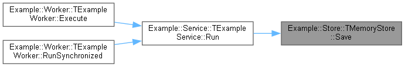
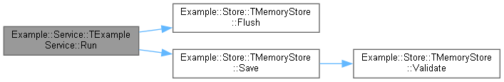

# Pas2Dox Modern

A standalone Windows Doxygen input filter for modern Delphi source, with static
call/caller graphs and Delphi IDE TODO support.

**Release candidate: 0.60.0-rc4.** Built with Delphi 11; tested with Doxygen 1.18.0
on Windows x64. See [features and limits](docs/SUPPORT.md).

[Magyar útmutató](README.hu.md) · [Release notes](RELEASE_NOTES.md) · [Contributing](CONTRIBUTING.md)

## Quick start

1. Install Doxygen and Graphviz; put `doxygen` and `dot` on PATH.
2. Extract the Windows x64 ZIP to a directory such as `C:\Tools\pas2dox-modern`.
   Keep the executable path free of spaces for Windows filter command handling.
3. Add these settings to your Doxygen configuration:

```ini
INPUT_ENCODING      = UTF-8
INPUT_FILTER        = "C:\Tools\pas2dox-modern\build\pas2dox.exe --delphi=11 --platform=win32"
FILTER_PATTERNS     =
FILTER_SOURCE_FILES = YES
EXTENSION_MAPPING  = pas=C++ PAS=C++ dpr=C++ DPR=C++
HAVE_DOT            = YES
CALL_GRAPH          = YES
CALLER_GRAPH        = YES
GENERATE_TODOLIST   = YES
GENERATE_HTML       = YES
GENERATE_LATEX      = YES
```

Keep your project's `INPUT`, `FILE_PATTERNS`, `RECURSIVE` and exclusions. Run
Doxygen/Doxywizard normally. Open `html/index.html` in its output directory;
compile the generated LaTeX separately for a complete PDF manual.

The executable runs without Python or Delphi installed. Delphi is needed to
build it; Python is needed only for optional tests.

**`FILTER_SOURCE_FILES = YES` is required for graphs too.** Omit `-i` for
implementation call sites. Select the source project's version/platform/defines
explicitly; an x64 filter can document a Win32 application.

## Try the public example

From the extracted release or a built checkout:

```powershell
.\build\pas2dox.exe --version
doxygen examples\Doxyfile
```

Open `build/example-docs/html/index.html`. The synthetic example uses an in-memory
store and a worker, with no database, network or hardware. It demonstrates
cross-unit calls, an anonymous callback and TODOs. Its console program is also
compilable with Delphi 11.

Who calls a routine:



What a routine calls:



## Delphi TODO comments

These ordinary comments become Doxygen `\todo` entries:

```pascal
// TODO: Improve error handling.
{ TODO 1 -oAlex -cUI : Review the dialog. }
(* TODO: A multiline description is supported too. *)
```

Priority, owner and category remain as text; the original filename/line is added.
Body tasks link to their containing retained routine, other tasks to the
unit/file. Active include, initialization/finalization, program-body and trailing
comments are included. Inactive branches and string literals are excluded.
`-i` includes interface tasks only.

File-level `@todo` and method TODOs enter the same list. A template such as
`@todo No general To-Do` still creates a task. Omit empty templates or use
`@note` for information; reserve `@bug`/`@deprecated` for actual issues/items.

## Build

Windows and a licensed Delphi Win64 compiler/RTL are required. Delphi 11 is the
compiler used for this candidate:

```powershell
.\build.cmd
# Or select a compiler:
.\build.cmd -Compiler "C:\Program Files (x86)\Embarcadero\Studio\22.0\bin\dcc64.exe"
```

The build tries `dcc64.exe` on PATH, then the standard Delphi 11 installation.
It creates `build/pas2dox.exe`; intermediates use a temporary directory and are
removed. An existing EXE is replaced after successful build/version/hash checks.
The SDK and DCUs are not bundled. If Windows blocks a downloaded script, review
and unblock that file; a global execution-policy change is not required.

## Tests

Python 3.10+, Doxygen and Graphviz are required; no third-party Python packages:

```powershell
python -X utf8 tests\run_tests.py
```

Use a built or extracted release EXE. The 67 tests comprise 47 declaration/encoding,
9 native graph and 11 TODO tests. They check actual XML relations, HTML/LaTeX
graph assets, TODO pages and failure behavior. Reproducers are synthetic.
See [validation](VALIDATION.json).

## Options and scope

```powershell
.\build\pas2dox.exe --help
```

Useful options: `--delphi=11|12|13`, `--platform=win32|win64`, repeatable `-DNAME`
and `-IPATH`, `--encoding=1250`, `--ast-json`, `-i`, `--no-call-graph`.
Defaults: Delphi 13, Win32, UTF-8. Encoding selects the BOM-less input fallback;
output stays UTF-8, including when the source uses Windows-1250.

Graphs show statically resolved source call sites, not a full runtime trace.
Dynamic dispatch, unknown receivers and ambiguous targets are incomplete.
Callback sites are labelled and do not prove callback execution. See the
[support matrix and limits](docs/SUPPORT.md), including newer-compiler gaps.

## License and origins

Filter code: GPL v2. Modified PasDoc subset: GPL-2.0-or-later, with original
notices retained. See [LICENSE](LICENSE), [third-party notices](THIRD_PARTY_NOTICES.md)
and [PasDoc provenance](source/pasdoc/ORIGIN.md).

This continues the idea of the original [Pas2Dox](https://sourceforge.net/projects/pas2dox/)
using a PasDoc-based native parser and a separate Doxygen backend. Legacy Flex
sources/binaries and private application code are not part of this distribution.
